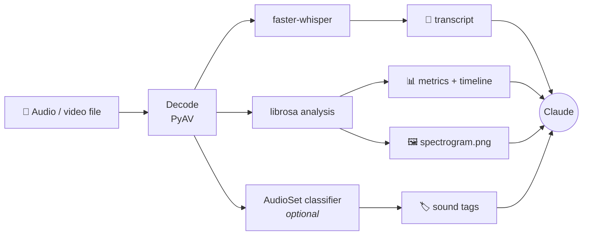

<div align="center">

# 🎧 claude-listen-audio

### Give Claude ears.

A [Claude Code](https://claude.com/claude-code) skill that turns any recording into something Claude can understand:<br>
a timestamped transcript, precise acoustic measurements, and a spectrogram it can actually *look at*.

[](https://claude.com/claude-code)
[](https://www.python.org/)
[](https://github.com/SYSTRAN/faster-whisper)
[](LICENSE)

**English** · [Türkçe](README.tr.md)

<a href="https://www.youtube.com/watch?v=knZadfUNXOc"></a>

<sub>▶ <a href="https://www.youtube.com/watch?v=knZadfUNXOc">Watch the 34-second demo</a> · <a href="https://www.youtube.com/watch?v=XZR8gpV7_Ys">Türkçe video</a></sub>

<br><br>


<sub>One clip, four sounds: speech (0–5.7 s) · silence · a pure 440 Hz tone · white noise. Claude reads this image and tells them apart.</sub>

</div>

---

## Contents

- [Why](#why)
- [What Claude gets](#what-claude-gets)
- [How it works](#how-it-works)
- [Install](#install)
- [Usage](#usage)
- [Example output](#example-output)
- [Performance](#performance)
- [Limitations](#limitations)
- [FAQ](#faq)
- [License](#license)

## Why

Claude reads text and sees images, but it **cannot hear**. Hand it a voice note, a meeting recording or a song and it has nothing to work with.

This skill closes that gap. It translates sound into the two forms Claude handles best, **numbers** and **pictures**, so it can answer questions like:

> *"What does this voice note say?"* · *"Summarize this 40-minute meeting."* · *"Is there background noise or hum?"*<br>
> *"What's the tempo and key of this track?"* · *"When does the music start?"* · *"Is the audio clipping?"*

## What Claude gets

| | Capability | Details |
|:-:|---|---|
| 🗣️ | **Transcript** | Timestamped speech-to-text via faster-whisper. Auto-detects 99 languages, Turkish included. Low-confidence lines are flagged, not passed off as fact. |
| 📊 | **Acoustic report** | Loudness (peak / RMS / dynamic range), clipping, silences and pauses, pitch and musical note, tempo (BPM), key, timbre, energy per frequency band. |
| 🕒 | **Timeline** | How the sound evolves window by window: level, brightness, noisiness, onsets, dominant pitch class. |
| 🖼️ | **Spectrogram** | Waveform + loudness curve + mel spectrogram as one PNG. Claude opens it and *sees* speech harmonics, tones, beats and noise. |
| 🏷️ | **Sound events** *(optional)* | AudioSet labels per 10 s chunk: Dog, Siren, Applause, Guitar, Car horn… 527 classes. |

Works with **mp3, wav, m4a, ogg, flac, opus, webm, mp4** and most other audio/video containers. No system ffmpeg required.

## How it works



Everything runs **locally** on your machine. No audio is uploaded anywhere; only the model weights are downloaded once from Hugging Face.

## Install

### As a plugin (recommended)

Inside Claude Code, run:

```
/plugin install listen-audio --marketplace digituvacom/claude-listen-audio
```

<sub>On Claude Code older than 2.1.275, use two steps: `/plugin marketplace add digituvacom/claude-listen-audio`, then `/plugin install listen-audio@digituva`.</sub>

Then install the Python dependencies once (Python 3.9+):

```bash
python -m pip install faster-whisper librosa matplotlib soundfile
```

Optional, for sound-event tagging:

```bash
python -m pip install transformers torch
```

Updates arrive with `/plugin update listen-audio`. If a dependency is missing, Claude notices on first use and tells you what to install.

### As a plain skill

```bash
git clone https://github.com/digituvacom/claude-listen-audio ~/.claude/skills/listen-audio
python -m pip install -r ~/.claude/skills/listen-audio/requirements.txt
```

<sub>Windows: `%USERPROFILE%\.claude\skills\listen-audio`. Restart Claude Code afterwards.</sub>

## Usage

### With Claude

Just mention a file. The skill triggers on its own:

```
> What does this say? ~/Downloads/voice-note.m4a
> Summarize the decisions in meeting.mp3
> Is there a 50 Hz hum in this recording?
> What's the BPM and key of track.wav?
```

### From the command line

```bash
python scripts/listen.py recording.mp3 --out ./out
```

| Flag | Default | Description |
|---|---|---|
| `--mode` | `all` | `transcribe`, `analyze` or `all` |
| `--model` | `small` | Whisper size: `tiny` · `base` · `small` · `medium` · `large-v3` · `turbo` |
| `--language` | auto | Force a language code, e.g. `en`, `tr`, `de` |
| `--tags` | off | Add AudioSet sound-event labels |
| `--start` / `--end` | full file | Analyse only a time range (seconds) |
| `--device` | `auto` | `cuda` or `cpu`; falls back to CPU automatically |
| `--timeline` | `12` | Number of timeline windows |

**Outputs** written to `--out`:

```
out/
├── report.md        # human-readable report (also printed to stdout)
├── report.json      # every number, machine-readable
├── transcript.txt   # [mm:ss → mm:ss] lines
└── spectrogram.png  # the picture Claude looks at
```

## Example output

<details open>
<summary><b>report.md</b> for the test clip shown above</summary>

```markdown
## Speech
language **en** (p=0.996), 5.8 s of speech, 1 segments, 0 low-confidence

[00:00.00 → 00:05.76] Hello, this is an audio test. The meeting will start at 3 o'clock this afternoon.

## Acoustics
- Loudness: peak 0.0 dBFS, RMS -15.2 dBFS, dynamic range 21.3 dB, clipping 0.031%
- Silence: 35% of the time, 5 sound regions; gaps ≥1s: 00:05.67–00:08.31
- Pitch: voiced 50%, median 194.9 Hz (G3), range D3–A4

### Timeline
| from     | to       | RMS dBFS | centroid Hz | flatness | pitch class |
|----------|----------|----------|-------------|----------|-------------|
| 00:08.24 | 00:09.27 | -11.5    | 442         | 0.0      | A           |  ← the 440 Hz tone
| 00:11.33 | 00:12.36 | -9.8     | 5667        | 0.548    | D#          |  ← white noise
```

</details>

## Performance

Rough transcription speed with the default `small` model:

| Hardware | Speed |
|---|---|
| NVIDIA GPU (CUDA 12) | ~20–40× real time |
| Modern laptop CPU | ~1–2× real time |

First use of each model downloads it once: `base` ≈ 150 MB · `small` ≈ 500 MB · `turbo` ≈ 1.6 GB.
The optional tagger downloads ≈ 350 MB.

## Limitations

- **No speaker diarization.** Whisper doesn't separate voices; "who said what" is inferred from content and pauses and labelled as such.
- **Music metrics on speech are noise.** Tempo and key are only meaningful for music.
- **Voice hints are hints.** Gender/age guesses come from median pitch alone and can be wrong.
- **Pitch analysis covers the first 90 s** to keep long files fast.

## FAQ

<details>
<summary><b>Does my audio leave my computer?</b></summary>

No. Decoding, transcription and analysis all run locally. The only network traffic is the one-time model download from Hugging Face.
</details>

<details>
<summary><b>The GPU isn't used.</b></summary>

faster-whisper needs the CUDA 12 cuBLAS and cuDNN libraries. Without them the script prints a notice and continues on CPU, so nothing breaks.
</details>

<details>
<summary><b>The transcript is wrong in places.</b></summary>

Use a larger model (`--model turbo` or `large-v3`) and, for short or mixed-language clips, force the language with `--language`.
</details>

<details>
<summary><b>It's a 2-hour file.</b></summary>

Use `--start` / `--end` for a first pass, or run the whole thing in the background. Claude will do this automatically for long files.
</details>

## License

[MIT](LICENSE) © 2026 Digituva Yazılım

<div align="center">
<sub>Built with Digituva Yazılım · Powered by <a href="https://github.com/SYSTRAN/faster-whisper">faster-whisper</a>, <a href="https://librosa.org">librosa</a> and <a href="https://matplotlib.org">matplotlib</a></sub>
</div>
